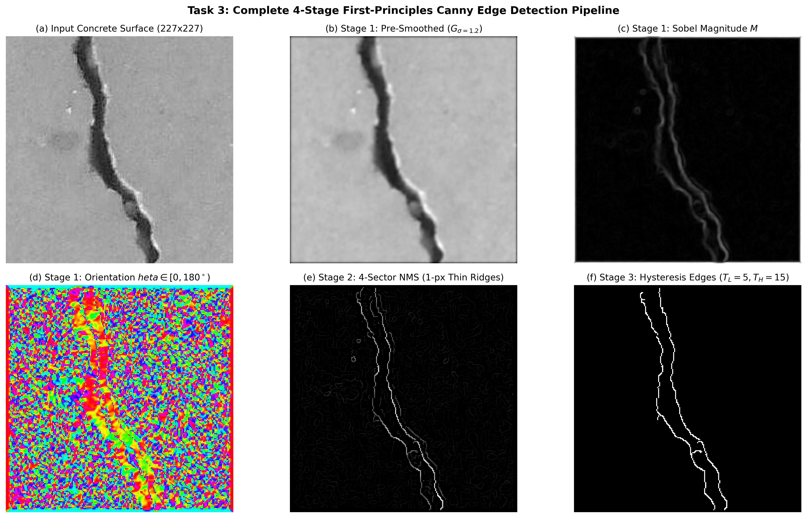

# Industrial Surface Inspection with First-Principles Filtering and Canny Edges

An edge-based inspection pipeline for PCB manufacturing flaws and concrete surface cracks, written in
pure NumPy. Convolution, Gaussian smoothing, unsharp masking, pooling and every stage of the Canny
edge detector are implemented from their mathematical definitions. No `cv2.filter2D`,
`cv2.GaussianBlur`, `cv2.Sobel`, `cv2.Canny` or SciPy filters are used; OpenCV is used only to read
images.



## What is implemented

| Module | Functions |
|---|---|
| `src/convolution.py` | `conv2d` (`same` / `valid`, stride) and `conv3d` for multi-channel inputs and kernel banks |
| `src/filtering.py` | Normalised Gaussian kernel synthesis, unsharp masking, 2D max / average pooling |
| `src/canny.py` | Sobel gradients with optional Gaussian pre-smoothing, 4-sector non-maximum suppression, 8-connected BFS hysteresis, and the full `canny_edge_detector` |
| `src/experiments.py` | Ablations and analyses that generate the task 2–5 figures in `output_images/` |
| `src/Assignment01_Industrial_Inspection.ipynb` | Walk-through notebook with outputs |

## Experiments

All figures are in [`output_images/`](output_images):

- Unsharp masking and pooling on PCB and concrete samples
- The four Canny stages on a concrete crack
- **Ablations:** noise vs. pre-smoothing, before vs. after non-maximum suppression, hysteresis vs. a single threshold
- **Scale-space causality** (Witkin): edges across increasing σ
- **Parameter sensitivity:** a 3×3 grid of (high, low) thresholds on both datasets
- **Failure cases:** strong illumination gradients over a PCB flaw, and high-frequency surface texture on concrete

The full write-up, including the gradient derivation for 2×2 max pooling, is in
[`docs/report.pdf`](docs/report.pdf).

## Data

The datasets are not included. Download them from their providers:

- **PCB defects**: the PCB_DATASET from the Open Lab on Human-Robot Interaction, Peking University (also mirrored on Kaggle)
- **Concrete cracks**: *Concrete Crack Images for Classification* (Özgenel, Mendeley Data, CC BY 4.0)

`src/experiments.py` reads three images, at these paths relative to the repository root:

```
data/pcb_defects/PCB_DATASET/images/Mouse_bite/01_mouse_bite_01.jpg
data/concrete_cracks/Positive/00001.jpg
data/concrete_cracks/Negative/00001.jpg
```

## Running

Requires Python 3.10+.

```bash
pip install -r requirements.txt
cd src
python experiments.py      # writes the task 2–5 figures to ../output_images/
```

The task 1 convolution figure is produced by the notebook.

## Limitations

- The implementation favours clarity and vectorised NumPy over speed; it is not meant to replace optimised libraries.
- Thresholds are tuned by hand on a few samples. There is no quantitative edge-accuracy benchmark against ground-truth annotations.
- Classical edges fail under strong illumination gradients and on textured backgrounds; the failure-case figure shows both.

> **Context.** Assignment 1 of CS4059 Fundamentals of Computer Vision, FAST-NUCES (Fall 2026).
